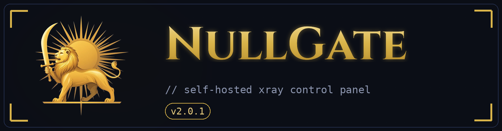

<div align="center">



<br><br>

[](https://github.com/XTLS/Xray-core)
[](https://lucity.cloud)
[]()
[]()
[]()
[]()

**NullGate** یک سرویس مبتنی بر **Xray-core** با پنل وب فارسی، لینک اشتراک، **اسکنر آی‌پی تمیز**، **FinalMask و Cipher Suites** و **پروفایل اپراتورهای ایران** (ایرانسل، همراه اول، رایتل و…) است.

</div>

> [!IMPORTANT]
> این پروژه صرفاً برای استفاده شخصی طراحی شده است.

---

## ⚡ تازه‌های نسخه ۲.۷.۰

| قابلیت | توضیح |
|---|---|
| 🚀 **دیپلوی روی Lucity** | `railpack.json` جای Dockerfile را می‌گیرد؛ nginx و Xray خودکار نصب می‌شوند — Railway و VPS هم همچنان کار می‌کنند |
| 🤖 **متغیرهای اتوماتیک** | دیگر **هیچ متغیری را دستی نسازید** — UUID و رمز پنل خودکار ساخته می‌شوند و رمز در لاگ استقرار (Deploy Logs) چاپ می‌شود |
| 📡 **اسکنر آی‌پی تمیز** | اسکن از داخل مرورگر خودتان روی رنج‌های Cloudflare (پورت ۴۴۳/۲۰۵۳/۲۰۸۳/۲۰۸۷/۲۰۹۶/۸۴۴۳)، مرتب‌سازی بر اساس تاخیر و اعمال بهترین IP روی همه کانفیگ‌ها با یک کلیک |
| 🥷 **FinalMask & Cipher Suites** | فرگمنت TLS برای عبور از فیلتر SNI + انتخاب اثر انگشت uTLS + مجموعه‌های رمزنگاری، همراه پیش‌نمایش زنده JSON |
| 📶 **پروفایل اپراتور** | ایرانسل، همراه اول، رایتل، شاتل، پارس‌آنلاین، مبین‌نت، مخابرات، آسیاتک — با پیش‌تنظیم آماده و قابل ویرایش |
| 🔧 **فیکس IP در کانفیگ‌ها** | وقتی آدرس اتصال IP است، SNI/Host روی دامنه واقعی می‌ماند تا گواهی TLS مطابقت کند و کانفیگ واقعاً وصل شود |

---

## 🚀 راه‌اندازی روی Lucity (بدون حتی یک متغیر دستی!)

> Lucity پلتفرم اروپاییِ جایگزین Railway است — [lucity.cloud](https://lucity.cloud)

1. وارد [lucity.cloud/app/login](https://lucity.cloud/app/login) شوید و با **GitHub** ادامه دهید؛ GitHub App لسیتی را نصب کنید و به این ریپو دسترسی بدهید.
2. **New ← GitHub Repository** را بزنید و این ریپو را انتخاب کنید.
3. لسیتی خودش همه‌چیز را تشخیص می‌دهد:
   - `requirements.txt` → پروژه پایتون (فقط stdlib، بدون وابستگی)
   - `railpack.json` → نصب nginx و دانلود آخرین Xray-core در زمان بیلد
   - `Procfile` → دستور اجرا: `python3 -u panel.py`
4. **هیچ Variable ای لازم نیست بسازید** — همه‌چیز اتوماتیک است:
   - `PORT` را خود لسیتی تزریق می‌کند
   - UUID و رمز پنل در اولین اجرا ساخته و ذخیره می‌شوند
5. **Settings ← Networking ← Port** را روی `8080` بگذارید (پیش‌فرض همین است) و **Generate Domain** را بزنید.
6. (پیشنهاد قوی) **Settings ← Volumes** یک Volume بسازید و روی مسیر `/data` سوار کنید تا کاربران و لینک‌ها با هر دیپلوی پاک نشوند.
7. **پنل**: `https://<دامنه>/panel`

> 🔑 رمز ورود کجاست؟ در **Deploy Logs** همان اولین اجرا چاپ شده: `username: admin` و `password: <UUID>` — بعد از ورود از تنظیمات عوضش کنید.

> ⚠️ **Reality روی Lucity**: لسیتی فقط دامنه HTTPS می‌دهد و پروکسی TCP ندارد؛ بنابراین کانفیگ Reality به‌صورت خودکار خاموش می‌ماند. پنج پروتکل HTTP (WS / XHTTP / HTTPUpgrade / VMess / Trojan) کامل کار می‌کنند. برای Reality روی VPS خودتان دیپلوی کنید و `TCP_HOST`/`TCP_PORT` را ست کنید.

### چرا Dockerfile لازم نیست؟

لسیتی **Dockerfile را نادیده می‌گیرد** و با Railpack از سورس بیلد می‌کند. برای همین `railpack.json` این کارها را انجام می‌دهد:

```json
{
  "steps": { "xray": { "commands": ["curl … Xray-linux-64.zip", "unzip … -d bin"] } },
  "deploy": { "startCommand": "python3 -u panel.py", "aptPackages": ["nginx", "…"] }
}
```

اگر بیلد به هر دلیلی Xray را نداشت، `panel.py` خودش در اولین اجرا آخرین نسخه را دانلود و در `/data/bin` کش می‌کند — یعنی **همیشه روشن می‌شود**.

---

## 📡 اسکنر آی‌پی تمیز — چطور کار می‌کند؟

اسکن **داخل مرورگر شما** اجرا می‌شود؛ یعنی تاخیرها دقیقاً مسیر اینترنتِ خودتان را نشان می‌دهند (نه مسیر سرور). IPهای تصادفی از کل رنج‌های رسمی Cloudflare ساخته می‌شوند و به `https://IP:PORT/cdn-cgi/trace` درخواست کور (no-cors) می‌فرستند — هرچه دست‌دادن سریع‌تر، IP تمیزتر.

بعد از اسکن، کنار هر نتیجه دکمه **«اعمال»** را بزنید:

1. IP انتخابی می‌شود **آدرس اتصال** همه لینک‌ها و ساب‌ها
2. SNI و Host روی **دامنه اصلی** می‌مانند تا گواهی TLS معتبر بماند (فیکس مهم نسخه ۲.۷.۰)
3. در کلاینت فقط `Update subscription` بزنید — همه کانفیگ‌ها عوض می‌شوند

اگر دامنه اختصاصی روی Cloudflare دارید که به سرویس اشاره می‌کند، در پنجره اعمال همان دامنه را بجای دامنه پیش‌فرض وارد کنید تا مسیر CDN کامل شود.

---

## 🥷 FinalMask و Cipher Suites و پروفایل اپراتور

تب **«بهینه‌سازی»** پنل:

- **FinalMask (فرگمنت TLS)** — بسته‌ی Handshake را تکه‌تکه می‌فرستد تا فیلتر SNI اپراتور دامنه را نبیند؛ قلب ترفند عبور از فیلترینگ ایران. حالت `tlshello` و اسلایس `1-3`، اندازه تکه‌ها، فاصله‌ها و سقف تکه‌ها قابل تنظیم‌اند.
- **Cipher Suites** — مجموعه‌های رمزنگاری TLS که در کانفیگ JSON اعمال می‌شوند (پریست‌های آماده TLS 1.3 / AES / ChaCha20 یا رشته دلخواه).
- **اثر انگشت TLS (uTLS)** — chrome / firefox / safari / ios / android / edge / random؛ در لینک‌های ساب هم اعمال می‌شود.
- **پروفایل اپراتور** — ایرانسل، همراه اول، رایتل، شاتل، پارس‌آنلاین، مبین‌نت، مخابرات و آسیاتک؛ با یک کلیک پیش‌تنظیم مناسب اپراتورتان پر می‌شود.

> FinalMask کامل و Cipher Suites در **«کانفیگ JSON بهینه»** (دکمه JSON هر کاربر) اعمال می‌شوند؛ لینک‌های ساب اثر انگشت و ALPN را می‌گیرند. برای فرگمنت، کلاینت شما باید Xray جدید (v25+) داشته باشد — v2rayNG/Hiddify به‌روز این را پشتیبانی می‌کنند.

---

## 🔧 مهاجرت از Railway

همان ریپو روی Railway هم بدون تغییر کار می‌کند (Dockerfile سر جایش است). برای انتقال کاربران: از پنل فعلی **پشتیبان (JSON)** بگیرید و در پنل جدید **بازیابی** کنید — کاربران، اینباندها، آدرس‌ها و بهینه‌سازی‌ها منتقل می‌شوند. لینک ساب جدید را به کاربران بدهید (توکن‌ها بر اساس UUID ساخته می‌شوند؛ اگر `UUID` را قبلاً ست کرده بودید، همان را در Railway/لسیتی نگه دارید تا لینک‌ها ثابت بمانند).

## متغیرها (همه اختیاری!)

| نام | پیش‌فرض | توضیح |
|---|---|---|
| `PORT` | `8080` | خود لسیتی/ریلوی تزریق می‌کند |
| `UUID` | خودکار | اگر ست کنید همه توکن‌ها از آن ساخته می‌شوند (برای مهاجرت) |
| `ADMIN_USER` | `admin` | نام کاربری پنل |
| `ADMIN_PASSWORD` | خودکار (UUID) | رمز پنل؛ اگر ست نکنید در لاگ چاپ می‌شود |
| `DOMAIN` | خودکار از هدرها | دامنه اختصاصی (در صورت نیاز) |
| `TCP_HOST` / `TCP_PORT` | — | فقط برای Reality روی VPS/Railway TCP Proxy |
| `XRAY_BUFFER` / `XRAY_IDLE` | `1024` / `600` | بافر (KB) و گرم‌ماندن تونل (ثانیه) |
| `XRAY_DOWNLOAD_URL` | آخرین ریلیز | اگر نسخه خاصی از Xray می‌خواهید |
| `SECRET` | = UUID | منبع توکن‌های ساب |

## لینک اشتراک (Sub)

در تب **کاربران** دکمه «کپی ساب» را بزنید و در کلاینت اضافه کنید:

- **v2rayNG**: منو ← Subscription group setting ← + ← چسباندن لینک ← Update subscription
- **Hiddify / Streisand / V2Box**: افزودن پروفایل از کلیپ‌بورد

## نکات

- با ساخت یا حذف کاربر، Xray چند ثانیه ری‌استارت می‌شود.
- ترافیک کاربران به شبکه داخلی پلتفرم و آدرس‌های خصوصی مسدود است.
- **تعداد نمونه (replicas) را روی ۱ نگه دارید** — پنل state محلی دارد؛ Volume هم سرویس را تک‌نمونه قفل می‌کند.
- پلن آزمایشی لسیتی سقف مصرف دارد؛ مصرف را در داشبورد دنبال کنید.

## معماری

```
کلاینت ──HTTPS──▶ Lucity/Railway ──▶ nginx (PORT)
                               ├─ /ws        → VLESS · WebSocket
                               ├─ /xhttp     → VLESS · XHTTP (packet-up)
                               ├─ /hu        → VLESS · HTTPUpgrade
                               ├─ /vmess     → VMess · WebSocket
                               ├─ /trojan    → Trojan · WebSocket
                               ├─ /panel     → پنل مدیریت
                               ├─ /sub/...   → لینک اشتراک
                               └─ /          → صفحه ظاهری

کلاینت(IP تمیز) ──TLS(SNI=دامنه)──▶ CDN ──▶ همین سرویس
```

## لایسنس

مطابق LICENSE ریپوی اصلی.
